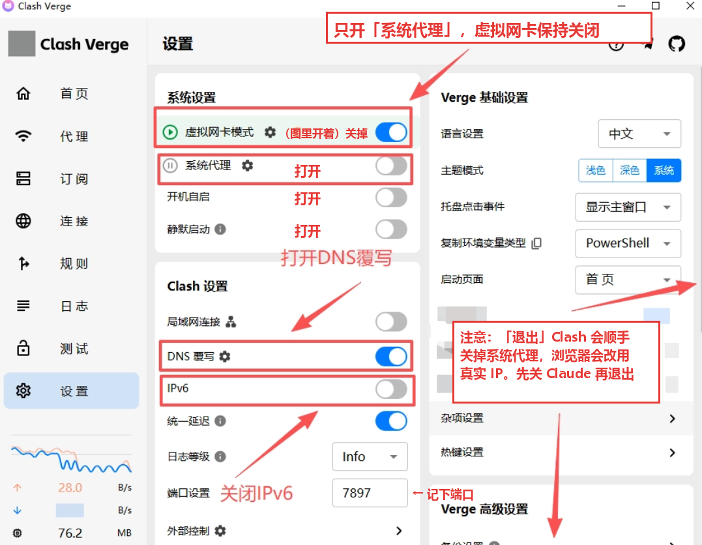

# 需要你亲手做的事

这套配置大部分由 AI 来做：改 Clash 的 DNS 和规则、关 IPv6、固定网卡 DNS、对时区、跑自检。这份文档只写 AI 做不了、必须你亲手做的几件事。AI 带你配置时，会告诉你什么时候看哪一节，照着做完回复它就行。

**适用范围**：Windows 10/11 + Clash Verge Rev。用 v2rayN 的看[附录 A](#附录-a用-v2rayn-的)，用 Mac 的看[附录 B](#附录-bmacos)。

> **⚠ 第一节做完之前，不要打开 Claude。** 网页、桌面端、Claude Code 都不要开，也不要让 Claude 来带你做第一节。在那之前，它们会直接用你的真实 IP 连接。

**AI 弹出管理员确认时**：屏幕上出现"你要允许此应用对你的设备进行更改吗？"，而 AI 刚说过要弹这个窗口，就点「是」。

---

## 一、先让代理跑起来

AI 自己也要靠代理联网，所以这一节要在 AI 开工之前由你做完，大约 15 分钟。

1. **准备。** 按 README「要买的东西」买好独享的静态 IP，拿到卖家给的订阅链接（`https://…`）。**订阅链接不要外传，也不要和别人共用。** 电脑上只留一个代理软件，其他代理客户端和加速器全部退出。
2. **装 Clash Verge Rev，导入订阅。**
   1. 到 GitHub 上的 `clash-verge-rev/clash-verge-rev`，进 Releases 页面，下载稳定版的 Windows x64 安装包（文件名带 `setup.exe`）并安装。安全软件拦截的话选允许。
   2. 打开 Clash Verge，在首页点「导入订阅」，粘贴订阅链接后导入。

      

   3. 进入「订阅」页，右键刚导入的订阅，选「使用」。

      

   导入失败或节点超时，看文末[常见问题](#常见问题)。
3. **选节点和模式。**

   

   - 在首页「当前节点」里选你买的那个静态 IP 节点。**选定以后不要来回换。**
   - 模式看订阅里有几个节点：只有一个（买静态 IP 一般是这样）就选「规则」；有好几个就选「全局」，不然出口可能在几个节点之间跳。
   - 全局模式下，银行、12306 这类网站可能要求额外验证，甚至拒绝访问。遇到时临时切到「规则」，用完再切回来，切换期间不要访问 Claude。
4. **设置页的开关。** 进入「设置」页，按下表拨好：

   

   | 开关 | 设为 | 为什么 |
   |---|---|---|
   | 系统代理 | 开 | 浏览器和 Claude 桌面端靠它走代理 |
   | 虚拟网卡模式 | 关（图里开着，那是原教程的状态） | 这套做法不用 TUN |
   | 开机自启、静默启动 | **开** | 开机后代理软件没起来，浏览器就会用真实 IP 上网 |
   | IPv6 | 关 | IPv6 流量会绕开代理 |
   | 局域网连接 | 关 | 用不到 |
   | DNS 覆写 | 先不动 | AI 改好内容后，第二节再打开 |

   再看一眼「端口设置」里的数字（默认 `7897`），下一条要用。
5. **设代理变量。** 不管用哪个 AI 工具带你配置，启动它之前都要先设好，否则它会用真实 IP 联网。从开始菜单打开「终端」（或「PowerShell」），粘贴下面这行，回车。端口不是 7897 的，把两处 7897 换成你的数字。

   ```powershell
   'HTTPS_PROXY', 'HTTP_PROXY' | ForEach-Object { [Environment]::SetEnvironmentVariable($_, 'http://127.0.0.1:7897', 'User') }; [Environment]::SetEnvironmentVariable('NO_PROXY', 'localhost,127.0.0.1,::1', 'User')
   ```

   设好以后，Clash 没开时 Claude Code 会直接报错，不会偷偷用真实 IP 连接。代价是 pip、npm、git 这些工具也会走代理，Clash 关着时它们连不上。
6. **把这个 skill 交给 AI。**
   1. 打开 `https://github.com/skepty2333/claude-antiban`，点绿色的「Code」→「Download ZIP」，解压。
   2. 把解压出来的文件夹改名为 `claude-antiban`，放进 AI 工具的 skills 文件夹：Claude Code 是 `C:\Users\你的用户名\.claude\skills\`，Codex 是 `C:\Users\你的用户名\.codex\skills\`。没有这个文件夹就新建一个。
   3. **关掉刚才的终端，新开一个**，再启动 AI。旧终端读不到刚设的代理变量。然后对它说"用 claude-antiban 帮我配置"。

**怎么确认**：用浏览器打开 `https://ip.net.coffee/claude/`，显示的是节点所在的国家。

## 二、让 Clash 重新加载配置

AI 改好 DNS 覆写和国内直连规则后，会请你做这一步。

进入「设置」页，找到「DNS 覆写」：关着的就打开；开着的就关掉再打开。

- **不要点它旁边的齿轮**去改内容，内容 AI 已经改好了。
- **不要用退出 Clash 再打开的办法来重启。** Clash 退出时会关掉系统代理，浏览器和 AI 会改用真实 IP 连接。

做完回复 AI，它会检查 Clash 是否已经用上新配置。之后如果网页打不开，先把「DNS 覆写」关掉，再告诉 AI，它会用备份还原。

## 三、浏览器设置

用你平时登录 Claude 的那个浏览器来做。这些设置都在浏览器里，AI 没法替你点。

### 3.1 WebRTC：装 WebRTC Network Limiter

WebRTC 是浏览器做音视频通话用的功能。它会绕过代理，直接探测你的真实 IP，必须限制住。下面的截图是 Chrome；用 Edge 的看本节末尾。

1. 打开扩展页面（作者是 Google），点「添加至 Chrome」：`https://chromewebstore.google.com/detail/webrtc-network-limiter/npeicpdbkakmehahjeeohfdhnlpdklia`

   

2. 点地址栏右边的拼图图标，打开扩展菜单。

   

3. 找到 WebRTC Network Limiter，点它右边的三个点 → 「选项」。

   

4. 选**最后一项**：**Use my proxy server (if present)**。

   

**Edge 的做法**：

1. 用 Edge 打开上面同一个链接。页面顶部会提示「允许来自其他应用商店的扩展」，点允许，再点「添加至 Chrome」（Edge 里也是这个按钮）。
2. 地址栏输入 `edge://extensions`，找到 WebRTC Network Limiter，点「详细信息」→「扩展选项」，同样选最后一项。

**其他浏览器**：

- **Firefox**：地址栏输入 `about:config`，把 `media.peerconnection.ice.default_address_only` 设为 `true`。
- **Safari**：默认不泄露，不用设。

### 3.2 关闭"安全 DNS"

- **Chrome**：地址栏输入 `chrome://settings/security`，关闭「使用安全 DNS」。
- **Edge**：地址栏输入 `edge://settings/privacy`，在「安全性」里关闭「使用安全 DNS」。
- **Firefox**：设置 → 隐私与安全 → 基于 HTTPS 的 DNS，选「关闭」。

### 3.3 浏览器语言（两处都要改）

1. **首选语言**：把节点所在国的语言（比如 English (United States)）**移到第一位**，中文删掉或移到后面。
   - Chrome：`chrome://settings/languages`
   - Edge：`edge://settings/languages`
2. **浏览器界面显示语言**：同一页里有「以这种语言显示 Google Chrome / Microsoft Edge」，也换成同一种语言，然后重启浏览器。检测网站读到的"区域设置"看的是这一项。

### 3.4 防止开机时抢跑

开机后，浏览器可能比 Clash 先启动，并自动恢复上次的 claude.ai 标签页，这一下走的就是真实 IP。

- **启动时打开**：选「打开新标签页」，不要选「继续上次浏览的内容」。
  - Chrome：`chrome://settings/onStartup`
  - Edge：`edge://settings/startHomeNTP`
- **Edge 还要多关两项**：在 `edge://settings/system` 里，关闭「启动增强」和「在 Microsoft Edge 关闭后继续运行后台扩展和应用」。

### 3.5 清理与习惯

- **清理痕迹**：接入新 IP 之前，清空这个浏览器的 Cookie 和缓存。更好的做法是新建一个浏览器用户（配置文件），专门登录 Claude。
- **无痕窗口**：Chrome 叫无痕模式，Edge 叫 InPrivate。它们默认不运行扩展，要在扩展详情里打开「在无痕模式 / InPrivate 中启用」，否则 WebRTC 扩展不起作用。
- **浏览器选择**：不要用 360、QQ、夸克、微信内置浏览器登录 Claude。

做完回复 AI。它会跑一遍完整自检，在你的浏览器里打开一个检测页，大约 15 秒，期间不要关掉这个页面。WebRTC、安全 DNS、语言是否设好，自检都会查到。

## 四、自己用网站复核（可选）

AI 的自检通过后，想自己再看一眼的话，用登录 Claude 的那个浏览器逐个打开下面的网站，结果应该和自检一致：

1. **IP 检测**：`https://ip.net.coffee/claude/`，一站式查看 IP、DNS、WebRTC。
2. **whatismyip**：`https://www.whatismyip.com/`。IP 归属地是节点所在国，并且 IPv6 显示 Not Detected。

   

3. **DNS 泄露检测**：`https://www.dnsleaktest.com/`，点 Standard Test，结果里不应出现 China。

   

4. **WebRTC 检测**：`https://browserleaks.com/webrtc`，应显示 No Leak。

   

5. **指纹评分**：`https://fuck-claude.vercel.app/zh/`，点「开始检测」，分数越低越好。

## 五、登录 Claude

AI 告诉你完整自检的"严重"为 0 以后，再做这一步。登录时用的是哪个 IP、什么样的环境，Claude 那边都看得到，所以要等环境配好了再登录。

- **账号和会员**：一般是买一个普号，再买 iOS 礼品卡充值的会员。推荐到 [PriceAI](https://priceai.cc/channels?platform=Claude) 上买，里面汇集了很多家卡网商家，各种需求基本都能找到，比好价直接点进对应的店铺下单。下单前看清店铺的售后说明。
- **登录**：用第三节设置好的浏览器登录，登录前确认 Clash 开着。
- **不要在手机上下载 Claude App。**

**怎么确认**：网页上能正常对话；开了会员的，在设置里能看到会员状态。

## 六、日常使用习惯

- **开机后**：Clash 会自动连上。等任务栏右下角出现 Clash 图标，再打开浏览器访问 Claude。
- **"关窗口"不是"退出"**：
  - 点 Clash 窗口右上角的 ×，只是把窗口收到任务栏，代理照常运行；
  - 右键任务栏图标选「退出」，才是真正关掉。
- **Claude 开着的时候，不要退出 Clash。** Clash 退出时会顺手关掉系统代理，浏览器和桌面端会改用真实 IP 连接。要退出，先关掉 Claude 的网页和桌面端。
- **节点固定**，不要来回切换。一个 IP 只登录一个 Claude 账号。
- **Claude Code 只在新开的终端里用**：设代理变量之前就开着的终端读不到它。
- **出现以下情况后，让 AI 跑一次自检**：换了网络（换 Wi-Fi、出差）、更新了订阅、换了节点。更新订阅后，原来选中的节点可能失效，要回第一节第 3 条确认。
- **手机**：不要在手机上下载 Claude App。

---

## 常见问题

- **订阅导入失败**：
  - 先检查链接是否复制完整；
  - 有的订阅地址在国内打不开，换个时间重试，或者找卖家要备用链接；
  - 实在不行，让卖家直接发配置文件，在「订阅」页用「新建」导入。
- **节点测速超时**：
  1. 确认电脑的系统时间准确。时间偏差大，加密连接会失败。
  2. 关掉其他代理软件和加速器。
  3. 仍然不通，联系卖家。
- **打开 DNS 覆写后网页打不开**：先把「DNS 覆写」关掉，网页就能恢复；再告诉 AI，它会用备份还原。
- **管理员确认窗口点了「否」，或者没看到就消失了**：告诉 AI，它会重新弹一次。

## 附录 A：用 v2rayN 的

第一节的第 2 到第 4 条换成下面这些，其余照常；第二节跳过，v2rayN 没有 DNS 覆写，DNS 设置保持默认即可。

1. 右键 v2rayN.exe，选「以管理员身份运行」。

   

2. 在节点列表空白处点一下，按 `Ctrl+V` 粘贴节点链接，再右键这个节点 →「设为活动」。

   

3. 底部的三个设置：
   - 「启用 Tun」：**关**；
   - 「系统代理」：选「自动配置系统代理」；
   - 「路由」：单节点选「绕过大陆」，需要全部走代理就选「全局」。

   左下角的 `mixed:10808` 就是端口号，第一节第 5 条的命令里把 7897 换成 10808。

   

4. **设成开机自启**：在「设置 → 参数设置」里勾选「开机自动启动」（不同版本位置略有不同）。和 Clash 一样，代理软件必须开机自启。

## 附录 B：macOS

- **Clash Verge Rev**：下载 macOS 版，Apple 芯片选 aarch64，Intel 芯片选 x64。第一节第 2 到第 4 条的界面和 Windows 一样，同样要打开「开机自启」。如果没生效，在 系统设置 → 通用 → 登录项 里把它加进去。
- **第一节第 5 条（代理变量）**：打开「终端」，粘贴下面这行回车（端口不是 7897 的换成你的）：

  ```bash
  printf '%s\n' '# >>> claude-antiban proxy >>>' 'export HTTPS_PROXY=http://127.0.0.1:7897' 'export HTTP_PROXY=http://127.0.0.1:7897' 'export NO_PROXY=localhost,127.0.0.1,::1' '# <<< claude-antiban proxy <<<' >> ~/.zshrc
  ```

- **skills 文件夹**：Claude Code 是 `~/.claude/skills/`，Codex 是 `~/.codex/skills/`。
- **带 `sudo` 的命令**：关 IPv6、改时区要输入开机密码，AI 会把命令给你，需要你自己在「终端」里运行。
- **浏览器**：Chrome 的设置和 Windows 一样；Safari 默认不泄露 WebRTC。

## 附录 C：电脑上装了虚拟机（VMware / VirtualBox / Hyper-V）

系统代理这条路线基本不受虚拟网卡影响。如果 Clash 连不上，按顺序排查：

1. 确认没开「虚拟网卡模式」。
2. 在设备管理器里临时禁用虚拟机的网卡，看问题是否消失。
3. 电脑开着热点时，不要同时开 TUN（本路线本来就不开）。

## 附录 D：想开 TUN 怎么办

只有一种情况值得开：搞不清哪些软件走没走代理，又必须让所有软件都走代理。做法和副作用见 `references/routing.md` 的"档位 B"。
