# 需要你亲手做的事

这套配置大部分由 AI 来做：检测、改 Clash 的开关和 DNS 覆写、关 IPv6、固定网卡 DNS、清理厂商字体、对时区。这份文档只写 AI 做不了、必须你亲手做的几件事。

怎么让 AI 开工，见 README 的「怎么开始」。它做到需要你的地方会停下来，告诉你看这里的哪一节，照着做完回复它就行。

**适用范围**：Windows 10/11 + Clash Verge Rev。用 v2rayN 的看[附录 A](#附录-a用-v2rayn-的)，用 Mac 的看[附录 B](#附录-bmacos)。

> [!CAUTION]
> **第三节换上你买的静态 IP 之前，不要打开 Claude。** 网页、桌面端都不要开。**也绝对不要用 Claude 来带你做这些配置**，用国产的 agent，或者 Codex 接你自己的 API（见 README）。在那之前，电脑用的要么是你的真实 IP，要么是临时代理那种很多人共用的 IP。

**AI 干活时需要你配合的几处**（为什么要这样，README 的「需要你配合的地方」里有解释）：

- **检测页别关**：AI 跑检测时会在浏览器里弹出一个检测页，大约 15 秒，等它显示"完成"再关。
- **管理员确认点「是」**：屏幕上出现"你要允许此应用对你的设备进行更改吗？"，而 AI 刚说过要弹这个窗口，就点「是」。它没提前说过的，不要点。
- **删字体要你同意**：AI 会先列出要删的字体，讲清楚影响和怎么恢复，你回复同意了它才删。删完按它说的重启电脑。
- **Clash 会被重启几次**：AI 改完 Clash 的设置会自动重启它，网页会断几秒，正常。
- **第三节之前买好 IP，第五节之前准备好 Claude 账号**：买什么、去哪买，见 README「要买的东西」。

---

## 一、让代理跑起来

AI 跑完第一遍检测后，会请你做这一节。先用你手头现有的代理订阅（比如原来的机场），第三节再换成你买的静态 IP。已经装好 Clash Verge 的，AI 会告诉你哪几条可以跳过。

1. **准备。** 找出你现在在用的那个代理订阅链接（`https://…`）。电脑上最后只留一个代理软件：Clash Verge 装好、能上网以后，再退出原来的代理客户端和加速器。退出时 AI 如果断线了，重新打开它说"继续"就行。
2. **装 Clash Verge Rev，导入订阅。**
   1. 到 GitHub 上的 `clash-verge-rev/clash-verge-rev`，进 Releases 页面，下载稳定版的 Windows x64 安装包（文件名带 `setup.exe`）并安装。安全软件拦截的话选允许。
   2. 打开 Clash Verge，在首页点「导入订阅」，粘贴订阅链接后导入。

      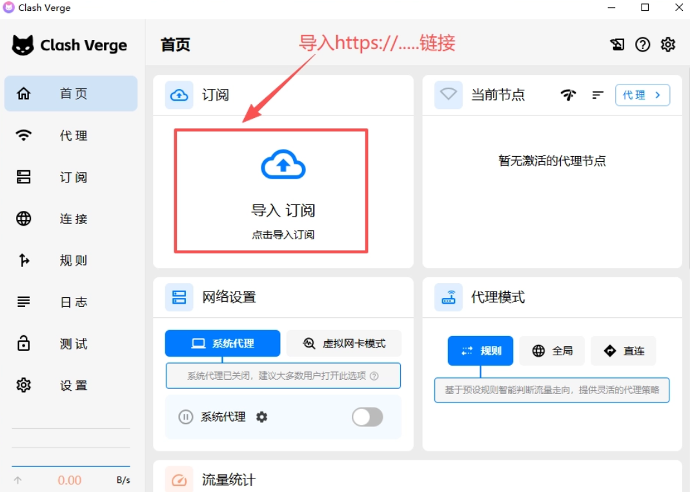

   3. 进入「订阅」页，右键刚导入的订阅，选「使用」。

      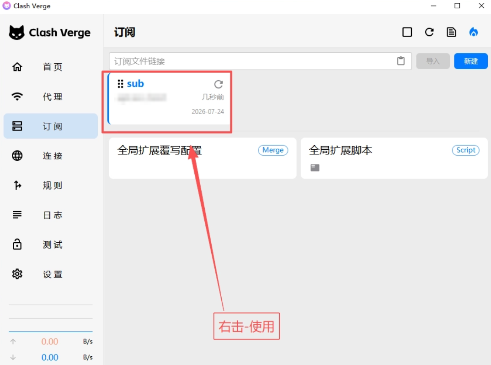

   导入失败或节点超时，看文末[常见问题](#常见问题)。
3. **选节点和模式。** 现在用的是临时订阅，先选一个能用的节点；节点多的，模式选「全局」。换上买的 IP 以后，第三节再重新选。

   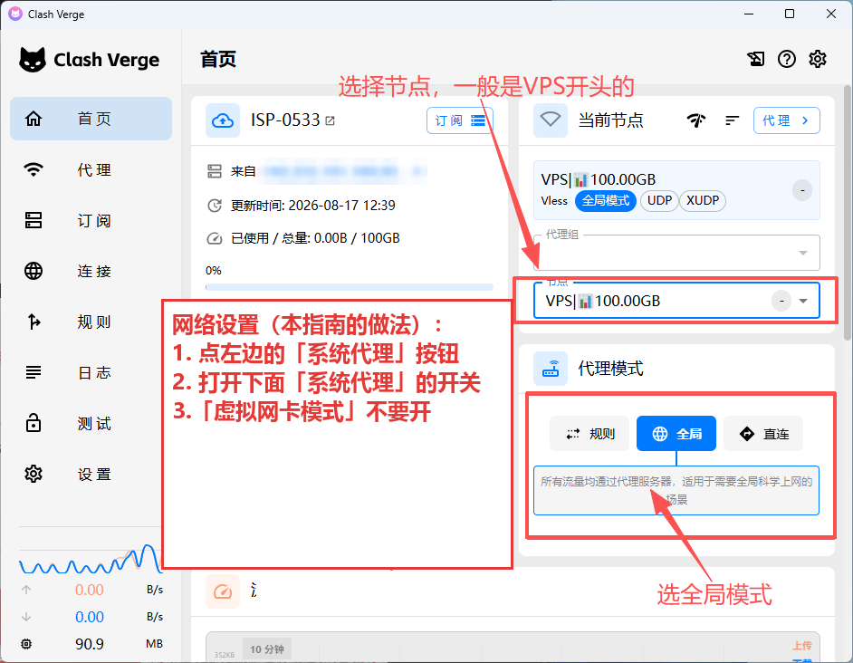

4. **设置页的开关不用你动。** 系统代理、虚拟网卡、开机自启、IPv6、DNS 覆写这些，AI 会直接改好，再重启 Clash 让它生效。给 Claude Code 用的代理变量也由 AI 来设。

**怎么确认**：用浏览器打开 `https://ip.net.coffee/claude/`，显示的是节点所在的国家。做完回复 AI。

## 二、浏览器设置

先选定一个浏览器专门用来登录 Claude，比如 Chrome，告诉 AI 是哪个；国内网站以后用另一个浏览器，比如 Edge。AI 会让这个浏览器的流量全走节点，网页和邮件就没法借国内直连拿到你的真实 IP；代价是用它上国内网站会慢，银行、12306 也可能不认。

下面的设置都在这个浏览器里做，AI 没法替你点。

> [!IMPORTANT]
> **以后网页版 Claude 只用这一个浏览器打开。** 下面这些设置只在这一个浏览器里生效，用别的浏览器打开 Claude，前面就白配了。

### 2.1 WebRTC：装 WebRTC Network Limiter

WebRTC 是浏览器做音视频通话用的功能。它会绕过代理，直接探测你的真实 IP，必须限制住。下面的截图是 Chrome；用 Edge 的看本节末尾。

1. 用这个浏览器打开它的扩展商店，找到 WebRTC Network Limiter（作者是 Google），点「添加至 Chrome」。可以在 Chrome 网上应用店里搜这个名字，也可以直接打开：`https://chromewebstore.google.com/detail/webrtc-network-limiter/npeicpdbkakmehahjeeohfdhnlpdklia`

   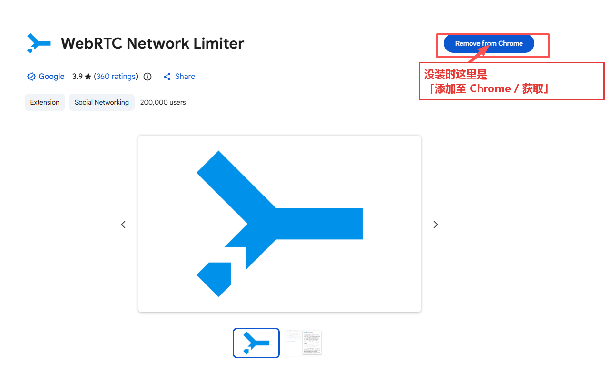

2. 点地址栏右边的拼图图标，打开扩展菜单。

   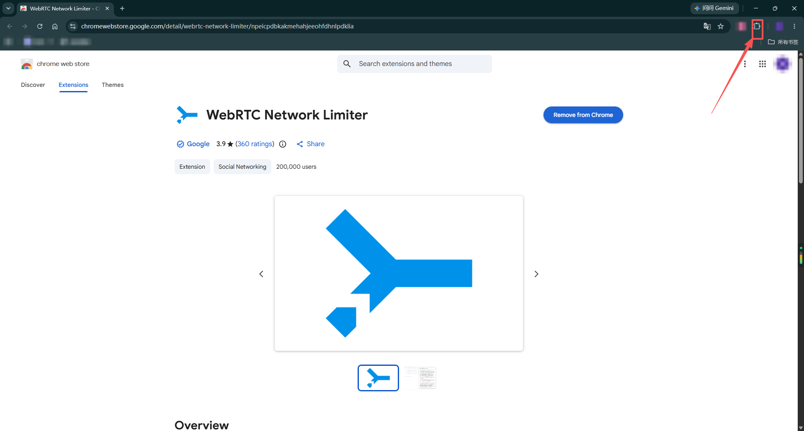

3. 找到 WebRTC Network Limiter，点它右边的三个点 → 「选项」。

   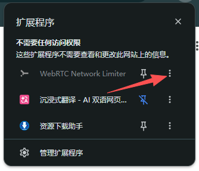

4. 选**最后一项**：**Use my proxy server (if present)**。

   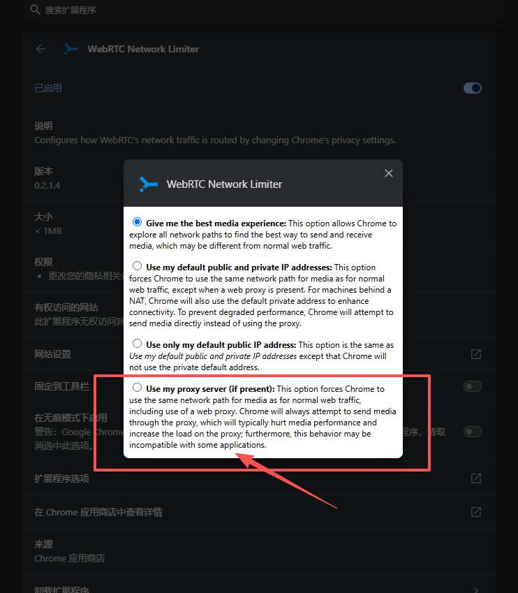

**Edge 的做法**：

1. 用 Edge 打开上面同一个链接。页面顶部会提示「允许来自其他应用商店的扩展」，点允许，再点「添加至 Chrome」（Edge 里也是这个按钮）。
2. 地址栏输入 `edge://extensions`，找到 WebRTC Network Limiter，点「详细信息」→「扩展选项」，同样选最后一项。

**其他浏览器**：

- **Firefox**：地址栏输入 `about:config`，把 `media.peerconnection.ice.default_address_only` 设为 `true`。
- **Safari**：默认不泄露，不用设。

### 2.2 关闭"安全 DNS"

- **Chrome**：地址栏输入 `chrome://settings/security`，往下翻到「高级」，关闭「使用安全 DNS」（英文界面叫 Use secure DNS）。

  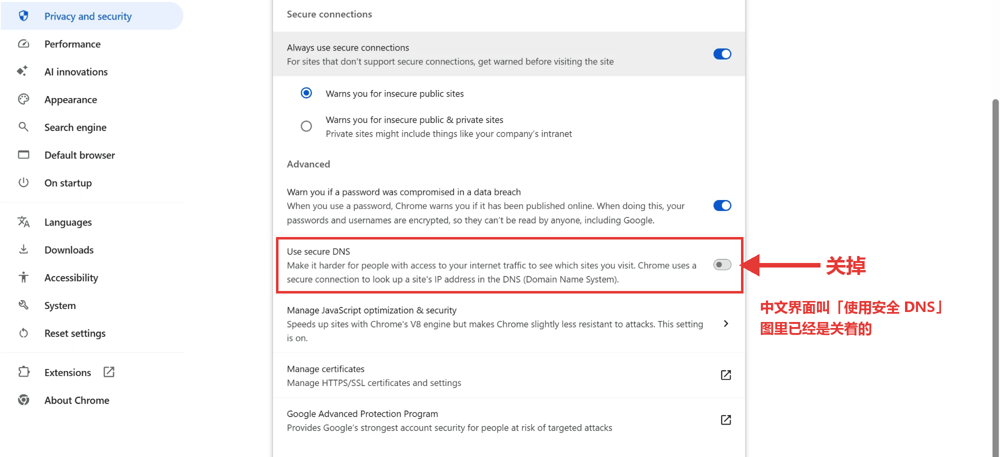

- **Edge**：地址栏输入 `edge://settings/privacy`，先点开「安全性」，再关闭里面的「使用安全的 DNS」。

  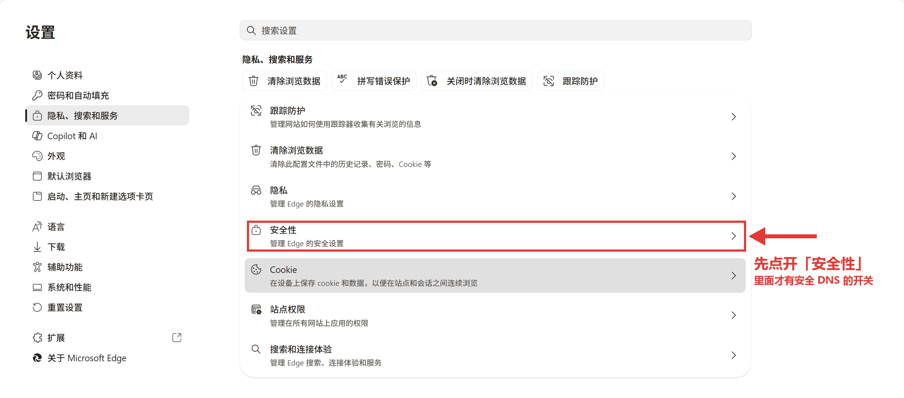

  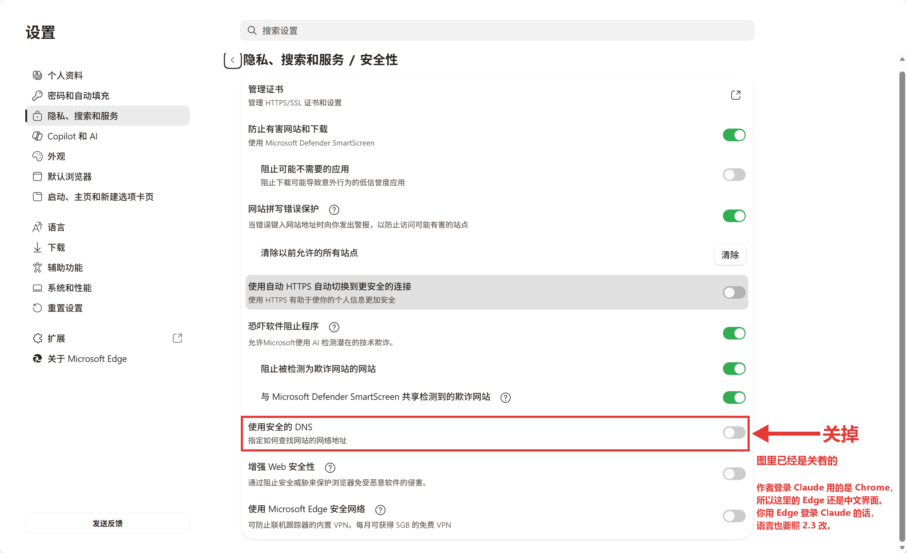

- **Firefox**：设置 → 隐私与安全 → 基于 HTTPS 的 DNS，选「关闭」。

### 2.3 浏览器语言（两处都要改）

语言要和你买的 IP 所在国一致。还没定买哪个国家的话，这一项先跳过，第三节换好 IP 再改。

1. **首选语言**：把 IP 所在国的语言（比如 English (United States)）**移到第一位**，中文删掉或移到后面。
   - Chrome：`chrome://settings/languages`
   - Edge：`edge://settings/languages`
2. **浏览器界面显示语言**：同一页里有「以这种语言显示 Google Chrome / Microsoft Edge」，也换成同一种语言，然后重启浏览器。检测网站读到的"区域设置"看的是这一项。

### 2.4 防止开机时抢跑

开机后，浏览器可能比 Clash 先启动，并自动恢复上次的 claude.ai 标签页，这一下走的就是真实 IP。

- **启动时打开**：选「打开新标签页」，不要选「继续上次浏览的内容」。
  - Chrome：`chrome://settings/onStartup`
  - Edge：`edge://settings/startHomeNTP`
- **Edge 还要多关两项**：在 `edge://settings/system` 里，关闭「启动增强」和「在 Microsoft Edge 关闭后继续运行后台扩展和应用」。

### 2.5 清理与习惯

- **清理痕迹**：接入新 IP 之前，清空这个浏览器的 Cookie 和缓存。更好的做法是新建一个浏览器用户（配置文件），专门登录 Claude。
- **无痕窗口**：Chrome 叫无痕模式，Edge 叫 InPrivate。它们默认不运行扩展，要在扩展详情里打开「在无痕模式 / InPrivate 中启用」，否则 WebRTC 扩展不起作用。
- **浏览器选择**：不要用 360、QQ、夸克、微信内置浏览器登录 Claude。

做完回复 AI。

## 三、换上你买的静态 IP

AI 把前面能做的都做完以后，会停在这里等你。**到这一步之前要买好独享的静态 IP**（怎么挑、去哪买见 README），拿到卖家给的订阅链接（`https://…`）。**订阅链接不要外传，也不要和别人共用。**

1. **导入新订阅**：和第一节第 2 条一样，在首页「导入订阅」，再到「订阅」页右键它，选「使用」。
2. **选节点和模式**：在首页「当前节点」里选你买的那个静态 IP 节点，一般以 VPS 或 ISP 开头。**选定以后不要来回换。** 模式看订阅里有几个节点：

   | 订阅里的节点 | 用哪个模式 | 为什么 |
   |---|---|---|
   | **只有一个**（买静态 IP 一般是这样） | **规则** | 海外网站走节点，国内网站直连，出口也不会跳 |
   | **有好几个** | **全局** | 规则模式下，订阅常把 Claude 分进"自动选择"组，出口会跳来跳去 |

   全局模式下，银行、12306 这类网站可能要求额外验证，甚至拒绝访问。遇到时临时切到「规则」，用完再切回来，切换期间不要访问 Claude。
3. **删掉临时订阅**：在「订阅」页右键原来那个临时订阅，删掉，免得以后误切回去。
4. **告诉 AI "IP 换好了"**。它会检查这个 IP 合不合格（出口国家、有没有滥用记录），给新订阅补上国内直连规则，然后重启 Clash。IP 不合格的话，它会请你找卖家换。
5. 第二节的浏览器语言还没改的，现在按 IP 所在国改好。

**怎么确认**：用浏览器打开 `https://ip.net.coffee/claude/`，显示的是你买的 IP 所在的国家。

## 四、自己用网站复核（可选）

AI 最后一遍检测通过后，想自己再看一眼的话，用登录 Claude 的那个浏览器逐个打开下面的网站，结果应该和检测一致：

1. **IP 检测**：`https://ip.net.coffee/claude/`，一站式查看 IP、DNS、WebRTC。在 Claude 专用的浏览器里，所有格子都应该是你的节点 IP，包括「中国出口 IPv4」和「网站分流测试」。用别的浏览器打开，这两项显示国内 IP 是正常的，那是国内直连在起作用。
2. **whatismyip**：`https://www.whatismyip.com/`。IP 归属地是节点所在国，并且 IPv6 显示 Not Detected。

   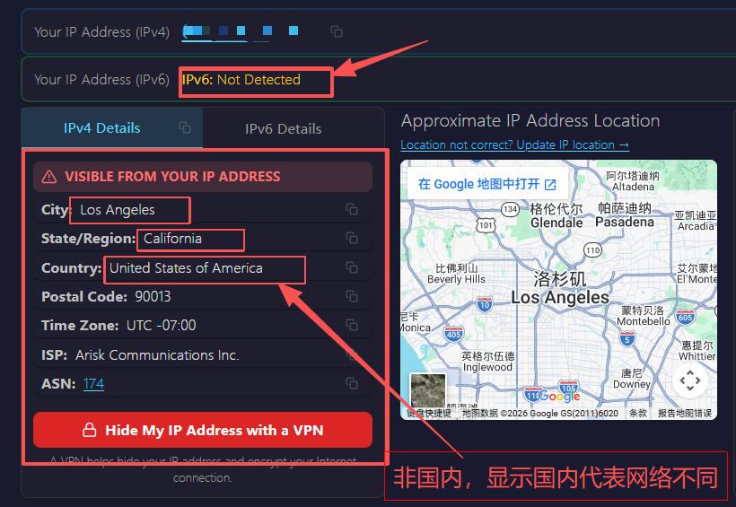

3. **DNS 泄露检测**：`https://www.dnsleaktest.com/`，点 Standard Test，结果里不应出现 China。

   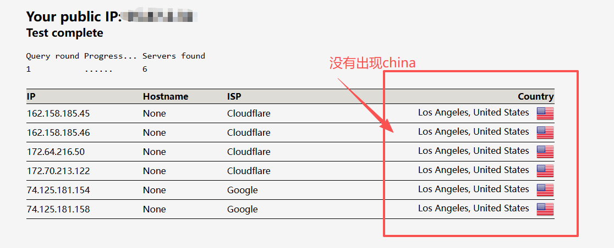

4. **WebRTC 检测**：`https://browserleaks.com/webrtc`，应显示 No Leak。

   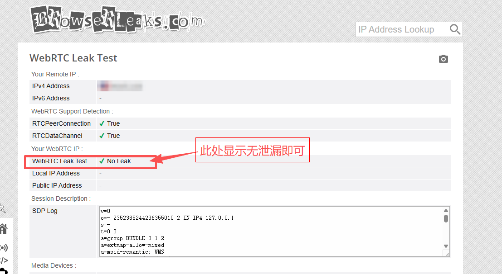

5. **指纹评分**：`https://fuck-claude.vercel.app/zh/`，点「开始检测」，分数越低越好。

## 五、登录 Claude

AI 告诉你最后一遍检测的"严重"为 0 以后，再做这一步。登录时用的是哪个 IP、什么样的环境，Claude 那边都看得到，所以要等环境配好了再登录。

- **账号和会员**：要在这一步之前准备好。一般是买一个普号，再买 iOS 礼品卡充值的会员。推荐到 [PriceAI](https://priceai.cc/channels?platform=Claude) 上买，里面汇集了很多家卡网商家，各种需求基本都能找到，比好价直接点进对应的店铺下单。下单前看清店铺的售后说明。
- **登录**：用第二节设置好的那个浏览器登录，以后也只用它；登录前确认 Clash 开着。
- **先用 72 小时再充会员**：普号登录后先正常用至少 72 小时，再充值。号刚到手就充，最容易被风控盯上。
- **不要在手机上下载 Claude App。**

**怎么确认**：网页上能正常对话；开了会员的，在设置里能看到会员状态。

## 六、日常使用习惯

- **开机后**：Clash 会自动连上。等任务栏右下角出现 Clash 图标，再打开浏览器访问 Claude。
- **"关窗口"不是"退出"**：
  - 点 Clash 窗口右上角的 ×，只是把窗口收到任务栏，代理照常运行；
  - 右键任务栏图标选「退出」，才是真正关掉。
- **Claude 开着的时候，不要退出 Clash。** Clash 退出时会顺手关掉系统代理，浏览器和桌面端会改用真实 IP 连接。要退出，先关掉 Claude 的网页和桌面端。
- **网页版 Claude 只用专用的那个浏览器打开，国内网站用另一个浏览器。**
- **节点固定**，不要来回切换。一个 IP 只登录一个 Claude 账号。
- **Claude Code 只在新开的终端里用**：设代理变量之前就开着的终端读不到它。
- **出现以下情况后，让 AI 跑一次检测**：换了网络（换 Wi-Fi、出差）、更新了订阅、换了节点。更新订阅后，原来选中的节点可能失效，要回第三节第 2 条确认。
- **手机**：不要在手机上下载 Claude App。
- **Claude 发来的邮件**（赠金、活动通知等）：只在专用浏览器里用网页邮箱打开，最好是 Gmail 网页版；不要在手机上或不走代理的邮件客户端里打开，也不要在那些地方点里面的链接。邮件里的追踪图片和跳转链接，会把打开时的 IP 带给发件方。

---

## 常见问题

- **订阅导入失败**：
  - 先检查链接是否复制完整；
  - 有的订阅地址在国内打不开，换个时间重试，或者找卖家要备用链接；
  - 实在不行，让卖家直接发配置文件，在「订阅」页用「新建」导入。
- **节点测速超时**：
  1. 确认电脑的系统时间准确。时间偏差大，加密连接会失败。
  2. 关掉其他代理软件和加速器。
  3. 仍然不通，联系卖家。
- **AI 改完 Clash 的设置后网页打不开**：告诉 AI，它会用备份还原并重启 Clash。急着用的话，可以先在 Clash「设置」页把「DNS 覆写」关掉。
- **管理员确认窗口点了「否」，或者没看到就消失了**：告诉 AI，它会重新弹一次。

## 附录 A：用 v2rayN 的

第一节第 2、3 条，以及第三节换 IP 时，换成下面这些，其余照常。AI 只会改 Clash Verge 的设置，v2rayN 的开关要你照下面第 3、4 条自己设；它没有 DNS 覆写，DNS 设置保持默认即可。

1. 右键 v2rayN.exe，选「以管理员身份运行」。

   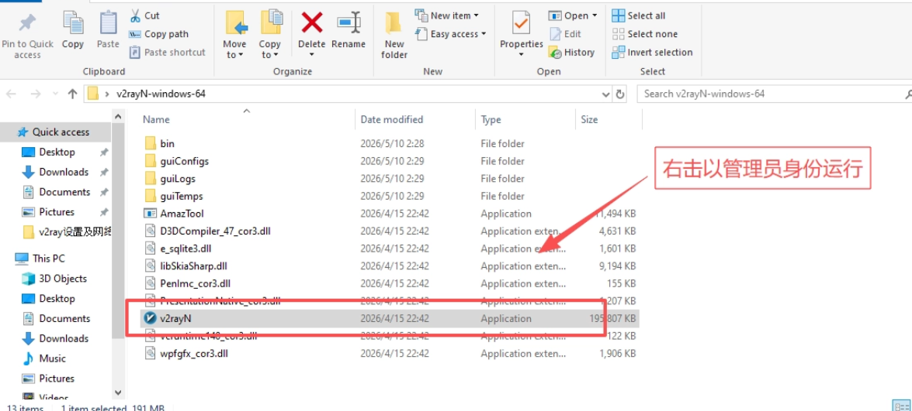

2. 在节点列表空白处点一下，按 `Ctrl+V` 粘贴节点链接，再右键这个节点 →「设为活动」。

   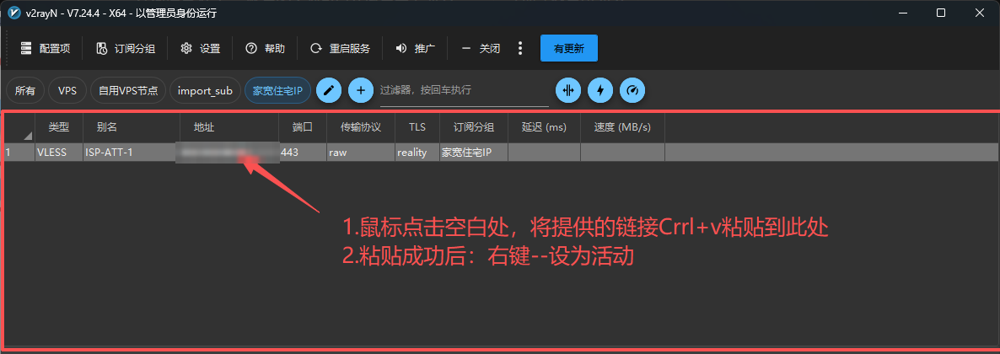

3. 底部的三个设置：
   - 「启用 Tun」：**关**；
   - 「系统代理」：选「自动配置系统代理」；
   - 「路由」：选「全局」。v2rayN 做不了 Clash 那种「专用浏览器全走节点」的规则，选「绕过大陆」的话，国内直连会给网页留下拿你真实 IP 的口子（原因见 README 第 3 步）；代价是国内网站也绕到海外，会慢一些。

   左下角的 `mixed:10808` 就是端口号，AI 问起端口时告诉它这个数字。

   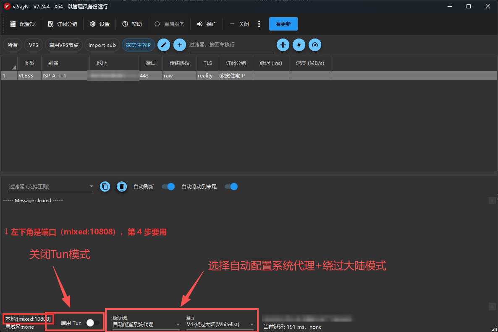

4. **设成开机自启**：在「设置 → 参数设置」里勾选「开机自动启动」（不同版本位置略有不同）。和 Clash 一样，代理软件必须开机自启。

## 附录 B：macOS

- **Clash Verge Rev**：下载 macOS 版，Apple 芯片选 aarch64，Intel 芯片选 x64。第一节第 2、3 条和第三节的界面和 Windows 一样，开关由 AI 来改。开机自启如果没生效，在 系统设置 → 通用 → 登录项 里把它加进去。
- **带 `sudo` 的命令**：关 IPv6、改时区要输入开机密码，AI 会把命令给你，需要你自己在「终端」里运行。代理变量 AI 自己就能设，不用你管。
- **厂商字体**：AI 会告诉你是哪几款，你在「字体册」里自己移除。
- **浏览器**：Chrome 的设置和 Windows 一样；Safari 默认不泄露 WebRTC。

## 附录 C：电脑上装了虚拟机（VMware / VirtualBox / Hyper-V）

系统代理这条路线基本不受虚拟网卡影响。如果 Clash 连不上，按顺序排查：

1. 确认没开「虚拟网卡模式」。
2. 在设备管理器里临时禁用虚拟机的网卡，看问题是否消失。
3. 电脑开着热点时，不要同时开 TUN（本路线本来就不开）。

## 附录 D：想开 TUN 怎么办

只有一种情况值得开：搞不清哪些软件走没走代理，又必须让所有软件都走代理。做法和副作用见 `references/routing.md` 的"档位 B"。
